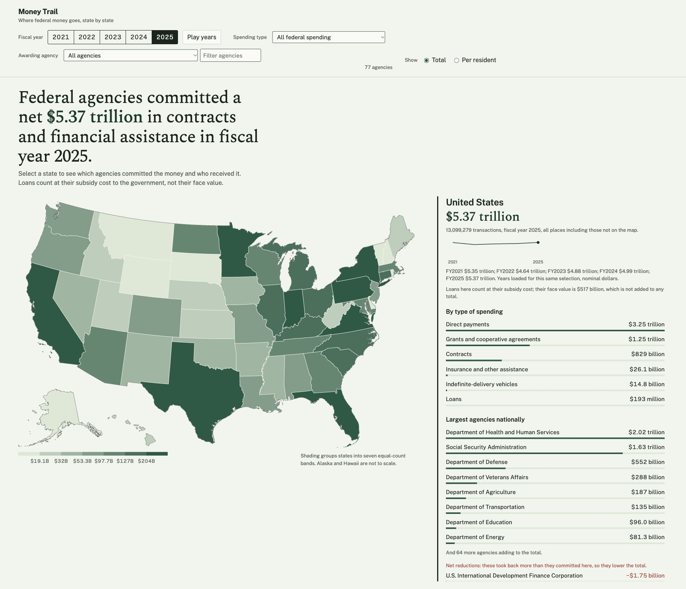
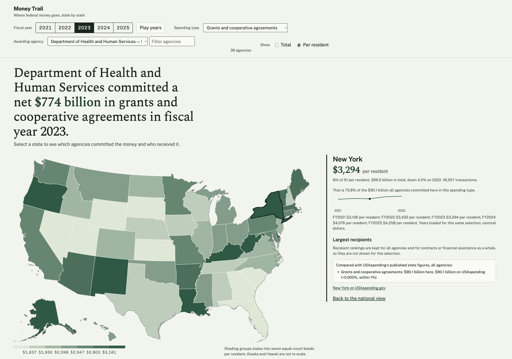
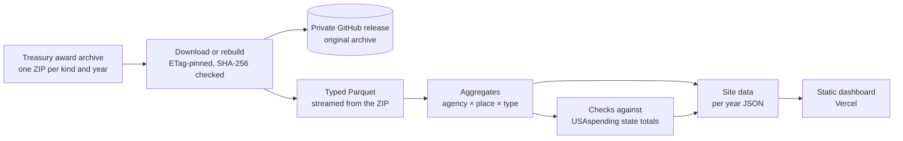

# Money Trail

**An interactive map of where US federal contracts, grants, loans and other awards were committed, state by state, fiscal years 2021–2025.**

**Live dashboard: [money-trail-delta.vercel.app](https://money-trail-delta.vercel.app/)**



Money Trail turns Treasury's national award archives into one map you can filter by year,
spending type and awarding agency. Every figure is rebuilt from the original files and checked
against USAspending's own published state totals; where they differ, the page says so.

| | |
| ---: | --- |
| **80,451,419** | federal award transactions loaded |
| **FY2021–FY2025** | five fiscal years, contracts and financial assistance |
| **51** | places on the map: the 50 states and DC (territories and abroad listed beside it) |
| **25,337** | agency × place × spending-type cells, the full matrix every figure is summed from |
| **10** | yearly builds, each with its source archive preserved and SHA-256 verified |

## What you can explore

- **Year:** step through FY2021–2025, or play them in sequence.
- **Spending type:** all federal spending, contracts (with or without indefinite-delivery vehicles),
  all financial assistance, or one kind: grants, direct payments, loans, insurance and other assistance.
- **Awarding agency:** every agency in the data, defence and civilian alike: Health and Human
  Services, Social Security, Veterans Affairs, Education, Agriculture and more. Map, ranks, table
  and totals all follow the choice.
- **Total or per resident:** shading, ranks and the state panel switch together.
- **A state's detail:** spending by type, the agencies behind it (agencies that took back more than
  they committed are listed apart), the largest recipients, and the trend across years.
- **Money off the map:** U.S. territories, work abroad, and spending with no usable location.
- **The checks:** a coverage table and, for each year and spending type, how the figures compare
  with USAspending.
- **Shareable views:** the address keeps year, type, agency, state and measure, so a link opens the
  same view.



*FY2023 grants from Health and Human Services, per resident, with New York selected.*

## How it works



Each year and kind (contracts or financial assistance) is built separately on a GitHub Actions runner,
one run at a time. The original archive is kept unchanged. Files above GitHub's 2 GiB limit are
stored as exact byte ranges with a manifest. A later rebuild uses only that preserved copy and
never contacts Treasury.

**Stack:** Python 3.13 · PyArrow · DuckDB · GitHub Actions and Releases · D3 and TopoJSON ·
plain HTML, CSS and JavaScript · Vercel (static hosting).

## Quality controls

- **Exact money.** Amounts are integer cents from source to page; no floating point.
- **Blocking checks.** Duplicate transaction keys, rows outside the fiscal year, unreadable amounts or
  dates, and award-type codes the category map does not know stop the build. Nothing is guessed or
  dropped silently.
- **Totals that add up.** The full agency × place × type matrix must equal every state, category and
  national total to the cent before anything is published.
- **Independent comparison.** Every spending type is compared with USAspending's state figures for
  the 50 states and DC, and every agency over the same places. Results are published as they come,
  including the failures.
- **Independent verification.** A second reviewer recomputed every matrix cell from the typed data
  with separate SQL and matched every one.
- **Provenance.** Each yearly build records its source file, SHA-256, code commit and run. Release
  assets are published only after every digest is checked. The page names them.
- **Bounded resources.** An 8 GiB free-space reserve is checked before every download, write and
  query spill.

## Known limitations

- **Obligations, not payments.** Figures are money agencies committed, net of money taken back, not
  cash paid out. Loans count at their subsidy cost (the government's expected cost), with face value
  shown separately.
- **Archive versus live site.** The archive is a snapshot (6 November 2026); USAspending's site is
  live. Financial assistance matches closely in almost every year and type. The exception is FY2025
  loans, which differ by $75.7 million, all of it Veterans Affairs. **Contracts do not match in any
  year:** the archive is $8–15 billion above the live state totals each year, mostly Defense. For
  FY2025 the cause is largely traced to re-issued transaction keys; for earlier years it is not
  established. The figures are shown as Treasury published them, with the differences disclosed.
- **Some types have no figure to compare.** For indefinite-delivery vehicles and assistance with no
  stated type, USAspending publishes no state figure, so these are marked unchecked.
- **Place is place of performance,** not the recipient's address. Some aggregate records, such as
  Medicare payments, sit with the reporting contractor.
- **Per resident** uses the latest population USAspending publishes, not each year's. Amounts are
  nominal dollars.
- **Scope.** Awarding agency only (no funding-agency view), prime awards only (no subawards), states
  only (no counties). Recipient rankings are shown only for a whole kind of award across all agencies.

## Run it locally

```sh
python3 -m http.server 8765 --directory site      # then open http://localhost:8765
```

Tests (offline, 144 of them) need Python 3.11+ with the pinned dependencies:

```sh
python3 -m venv .venv && .venv/bin/pip install -r requirements.txt
.venv/bin/python -m unittest discover -s tests
```

Rebuilding a year from its preserved archive needs access to the private releases; see
[engineering notes](docs/ENGINEERING.md#reproduce).

## Deployment and data access

The dashboard is a static folder (`site/`) deployed **by hand** to Vercel. No automatic deployment is
set up, so changes merged to `main` go live only when someone redeploys. The repository, the
preserved source archives and the build releases are private; the page names them as text for
provenance.

## Further reading

- [Engineering notes](docs/ENGINEERING.md): the build, reproduction, release record, detailed
  check results and the earlier per-agency pilot
- [Measurements](docs/measurements/national-fy2021-2025.md): sizes, run times and every comparison
- [Decisions](docs/decisions/): scope, ingestion, preservation, the typed layer and
  [spending categories](docs/decisions/006-assistance-and-categories.md)
- [What's next](docs/NEXT.md): open items. Counties, FY2008–2020 and full change tracking between
  snapshots are not built yet.

Data: [USAspending.gov](https://www.usaspending.gov), US Department of the Treasury.
